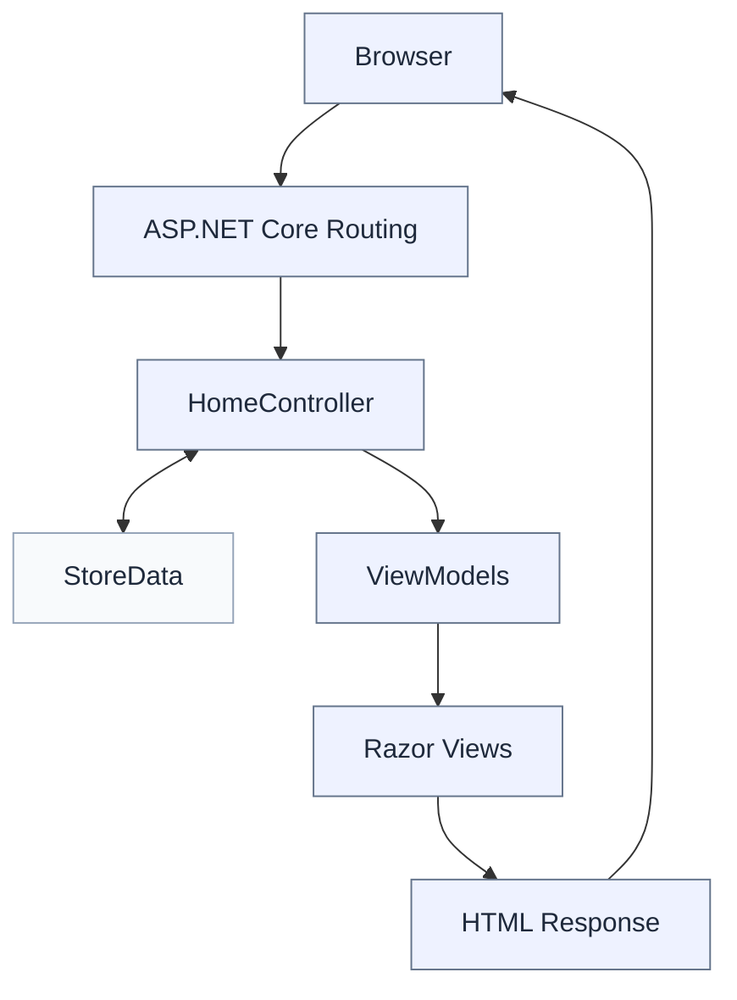

# XuanDucShop

**A simple store management web application built with ASP.NET Core MVC.**

XuanDucShop là ứng dụng quản lý cửa hàng với các chức năng quản lý danh mục, sản phẩm, nhân viên và hóa đơn. Dự án được xây dựng nhằm thực hành mô hình MVC, xử lý dữ liệu, validation và CRUD trong ASP.NET Core.

[**Repository**](https://github.com/xduc199/XuanDucShop) · ASP.NET Core MVC · .NET 10 · Bootstrap 5

---

## Overview

Ứng dụng cung cấp một giao diện quản trị tập trung, cho phép theo dõi dữ liệu cửa hàng và thực hiện các thao tác quản lý cơ bản.

| Dashboard | Store Management |
|---|---|
| Tổng quan số liệu và hóa đơn gần đây | Quản lý dữ liệu qua các trang danh sách và biểu mẫu |

### Features

- **Dashboard** — tổng hợp số liệu và hiển thị hóa đơn gần đây.
- **Categories** — quản lý danh mục sản phẩm.
- **Products** — quản lý thông tin, giá bán, tồn kho và trạng thái sản phẩm.
- **Employees** — quản lý thông tin nhân viên.
- **Invoices** — quản lý hóa đơn và thông tin khách hàng.
- **Invoice details** — quản lý sản phẩm, số lượng, đơn giá và thành tiền.
- **Validation** — kiểm tra dữ liệu đầu vào và các quan hệ nghiệp vụ.
- **Responsive UI** — giao diện sử dụng Bootstrap, hỗ trợ nhiều kích thước màn hình.

## Tech Stack

| Layer | Technology |
|---|---|
| Backend | C#, ASP.NET Core MVC, .NET 10 |
| Frontend | Razor Views, HTML5, CSS3, JavaScript |
| UI | Bootstrap 5 |
| Validation | Data Annotations, server-side validation |
| Data storage | In-memory |

## Architecture

XuanDucShop sử dụng mô hình MVC, kết hợp `StoreData` để quản lý dữ liệu trong bộ nhớ và ViewModel để chuẩn bị dữ liệu cho giao diện.



### Core models

```text
Category
   └── Product

Employee
   └── Invoice
         └── InvoiceDetail
                └── Product
```

Các quan hệ trên được quản lý và kiểm tra trong logic ứng dụng; dự án hiện chưa sử dụng cơ sở dữ liệu quan hệ.

## Project Structure

```text
XuanDucShop/
├── Controllers/
│   └── HomeController.cs
├── Models/
│   ├── Category.cs
│   ├── Product.cs
│   ├── Employee.cs
│   ├── Invoice.cs
│   ├── InvoiceDetail.cs
│   └── ViewModels/
├── Services/
│   └── StoreData.cs
├── Views/
│   ├── Home/
│   └── Shared/
├── wwwroot/
│   ├── css/
│   └── lib/
├── Program.cs
├── appsettings.json
└── XuanDucShop.csproj
```

| Directory | Responsibility |
|---|---|
| `Controllers` | Tiếp nhận request và điều phối xử lý |
| `Models` | Định nghĩa dữ liệu nghiệp vụ |
| `Models/ViewModels` | Chuẩn bị dữ liệu cho các trang và biểu mẫu |
| `Services` | Quản lý dữ liệu in-memory |
| `Views` | Giao diện Razor |
| `wwwroot` | CSS, JavaScript và tài nguyên tĩnh |

## Getting Started

### Requirements

- [.NET 10 SDK](https://dotnet.microsoft.com/download/dotnet/10.0)
- Git

### Installation

```bash
git clone https://github.com/xduc199/XuanDucShop.git
cd XuanDucShop
dotnet restore
dotnet build
dotnet run
```

Sau khi ứng dụng khởi động, mở địa chỉ HTTP hoặc HTTPS được hiển thị trong terminal.

## Data & Validation

Ứng dụng hiện sử dụng dữ liệu mẫu được quản lý bởi `StoreData`.

- Dữ liệu được dùng chung trong phiên chạy của ứng dụng.
- Validation được thực hiện phía server; các biểu mẫu hỗ trợ validation phía client.
- Các thao tác CRUD kiểm tra dữ liệu và những quan hệ nghiệp vụ liên quan.
- Tổng tiền hóa đơn được tính lại phía server dựa trên các chi tiết hóa đơn.

> **Current limitation:** Dữ liệu được lưu trong bộ nhớ và sẽ mất khi ứng dụng khởi động lại. Chưa tích hợp Entity Framework Core, database, xác thực người dùng hoặc bộ test tự động.

## Roadmap

- [ ] Tích hợp Entity Framework Core và SQL Server.
- [ ] Bổ sung xác thực và phân quyền.
- [ ] Thêm tìm kiếm và phân trang.
- [ ] Xây dựng bộ kiểm thử tự động.
- [ ] Hoàn thiện quy trình upload ảnh sản phẩm.

## Development

Khi đóng góp thay đổi, hãy tạo branch riêng, kiểm tra diff và chạy build trước khi tạo Pull Request.

```bash
git checkout -b feature/your-feature
dotnet build
```

---

<p align="center">
  <strong>XuanDucShop</strong><br>
  <sub>Store management · ASP.NET Core MVC · .NET 10</sub>
</p>
